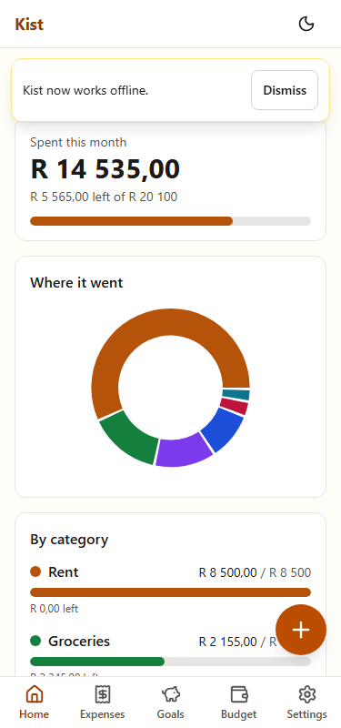
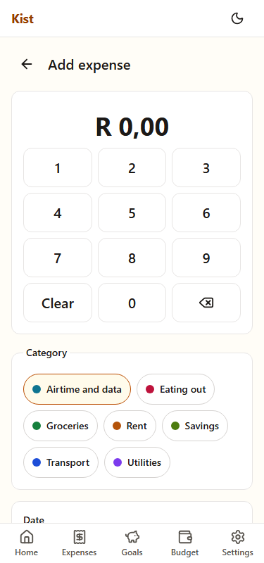
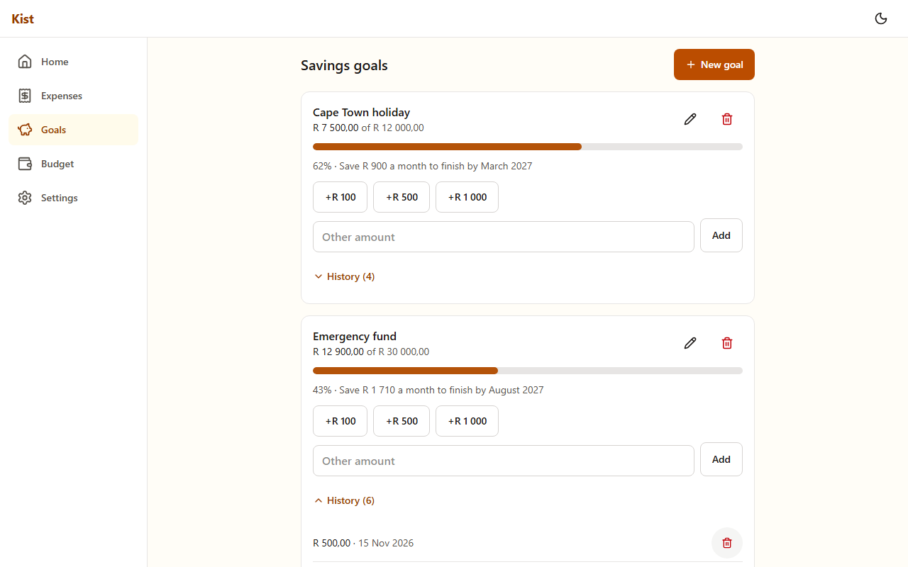
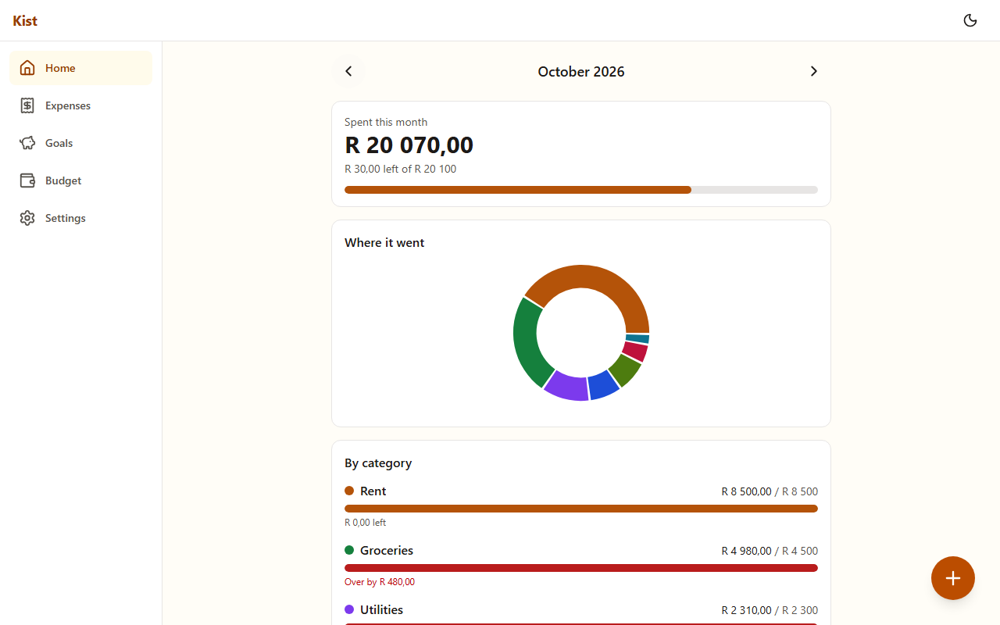
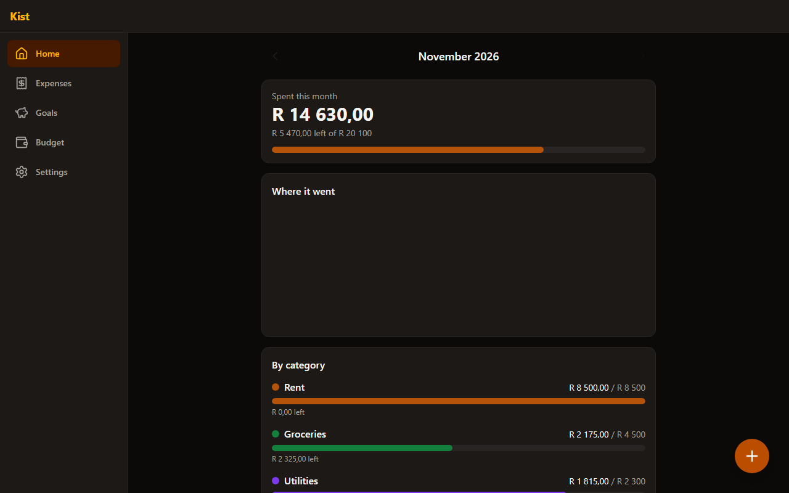

# Kist

An offline-first household budget app. Set monthly limits per category, log expenses with a big numeric keypad, watch spent versus budget, and track savings goals. Everything lives on the device, so it works with no signal and installs like a native app.

**Live demo:** https://kist-budget.netlify.app



## What to demo to a recruiter
- Open it: a demo household with three months of South African-style spending is already loaded. Step back a month to see Groceries in the red, then forward again.
- Tap the + button and enter an expense on the keypad (1, 2, 5, 0 reads R 12,50). Switch the browser to offline, add another, reload, and it is still there. No spinner, no sign-in, no network in the render path.
- Open Goals: tap +R500 on a goal and watch it say how much to set aside each month to hit its deadline. Then Export backup, Delete all data, and Import it back.

## Features
- **Offline data layer:** categories with monthly limits, expenses (amount, category, date, note) with edit and delete, all in IndexedDB through Dexie. UI reads with live queries, writes through small repos.
- **Monthly view:** month switcher, total and per-category spent versus limit with progress bars, overspend flagged in words and colour, and a donut chart of where the money went.
- **Savings goals:** target, saved so far and optional deadline, quick "add money" buttons plus a custom amount, contribution history you can undo, and the monthly amount needed to land on the deadline.
- **Touch first:** 44px-plus tap targets, bottom navigation, a till-style keypad (digits shift in from the right) and undo after deleting an expense.
- **Installable PWA:** manifest, icons, precached shell, and an update banner that lets the user choose when to reload.
- **Backup and restore:** export everything to JSON, validate before import (a corrupt file changes nothing), and switch currency between ZAR, USD, EUR and GBP.

### Phase 2
- Background sync to Neon (design below)
- Recurring expenses
- CSV export
- Multi-user households

## Stack
React 19, Vite, TypeScript (strict), Tailwind CSS 4, Dexie (IndexedDB), React Router, Recharts, zod, vite-plugin-pwa, Vitest.

## Architecture notes
- **Offline first means the network is never in the render path.** Screens use `useLiveQuery` on Dexie and write through repos; there is no fetch anywhere in the app today.
- **Money is integer cents** and only formatted at display. `parseAmountToCents` copes with "R 1 234,50", "1,234.50" and "12.5"; the keypad builds cents directly, so there is no floating point to drift.
- **Sync-ready data:** every record has a client-generated UUID, `updatedAt`, and a soft-delete `deletedAt`. Deleting a category keeps its past spending visible (as a "removed" row) so monthly totals always match the expense list.
- **Goals stay consistent:** `saved` is changed in the same transaction as the contribution that caused it, and a test checks `saved` always equals the sum of contributions.
- **Pure logic with tests:** `lib/budget.ts` (monthly summary), `lib/goals.ts` (progress and monthly target), `lib/money.ts`, `lib/backup.ts` (zod-validated import).
- **Schema versioning:** `db/schema.ts` uses `this.version(1)`; future changes add a new version block rather than editing a shipped one.
- The chart library is code-split so the numbers paint first.

### Sync design (Phase 2)
Last-write-wins per record. The client pushes records changed since its last sync to a Netlify Function (which writes to Neon), then pulls everything with `updatedAt` after its last-sync timestamp, applying newer rows locally. Soft deletes travel as ordinary updates. Failed syncs retry when the browser fires `online`. A per-household passcode scopes the data.

## Run locally
```bash
npm install
npm run dev          # http://localhost:5173
```
Checks: `npm run typecheck`, `npm run lint`, `npm test` (50 tests), `npm run build`. Try the installable, offline build with `npm run build && npm run preview`.

## Screenshots
| Add expense | Goals | Last month | Dark theme |
| --- | --- | --- | --- |
|  |  |  |  |

## Status
Built and tested locally. Deploy pending. Offline behaviour is verified in an automated browser run (service worker, offline reload, adding data offline); an install-and-airplane-mode test on a real phone is still to do.
